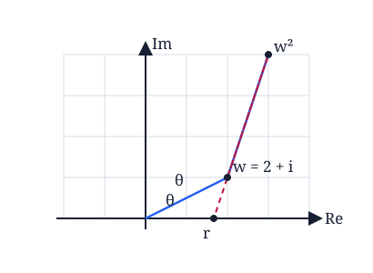

# 2025 AMC 12A Problem 9

## Problem
Let w be the complex number 2+i, where $i=\sqrt{-1}.$ What real number r has the property that r, w, and $w^2$ are three collinear points in the complex plane?

$\textbf{(A)}~\frac34\qquad\textbf{(B)}~1\qquad\textbf{(C)}~\frac75\qquad\textbf{(D)}~\frac32\qquad\textbf{(E)}~\frac53$
## Solution 1 (Rectangular Form)
First calculate

$$
w^2=(2+i)^2=4+4i-1=3+4i.
$$

Thus $w$ and $w^2$ correspond to the points $(2,1)$ and $(3,4)$ in the complex plane. The slope of the line through them is $\frac{4-1}{3-2}=3$, so its equation is

$$
\begin{align*} y &= 3(x-2)+1 \\ y &= 3x-5. \end{align*}
$$

The required number $r$ lies on both this line and the real axis, so it is the $x$-intercept. Setting $y=0$ gives $x=\boxed{\textbf{(E) }\frac{5}{3}}$.

*~lprado (minor edits ~Logibyte)*
## Solution 2 (Polar Form)
Recall that the slope of a line is $m=\tan\phi,$ where $\phi$ is the angle formed by the line and the positive x-axis.

Note that |w|=$\sqrt{2^2+1^2}=\sqrt{5}.$ In polar coordinates, let $w=\sqrt{5}$\operatorname{cis}$\theta.$ It follows that $\tan\theta=\frac12.$

By De Moivre's Theorem, we have $w^2=5$\operatorname{cis}($2\theta),$ from which $\tan(2\theta)=\frac{2\tan\theta}{1-\tan^2\theta}=\frac{4}{3}.$

We obtain the following diagram:

Since $\left$|$w^2\right$|=5, we have $w^2=3+4i$ by a 3-4-5 triangle. The complex numbers w and $w^2$ correspond to the points (2,1) and (3,4), respectively, and r corresponds to the x-intercept of this line. In slope-intercept form, the line containing these two points is y=$3x-5$. Therefore, the x-intercept is $r=\boxed{\textbf{(E)}~\frac53}.$

*~MRENTHUSIASM*
## Video Solution (Quick and Intuitive!)
https://youtu.be/k-HoA8XEHl4

*~Education, the Study of Everything*
## Video Solution by Power Solve
https://www.youtube.com/watch?v=Oy5hEE1fmJU
## Video Solution by SpreadTheMathLove
https://www.youtube.com/watch?v=dAeyV60Hu5c
