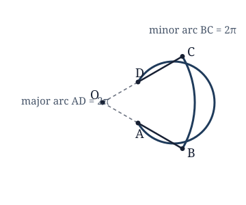

# 2025 AMC 12A Problem 10

## Problem
In the figure shown below, major arc $\widehat{AD}$ and minor arc $\widehat{BC}$ have the same center, O. Also, A lies between O and B, and D lies between O and C. Major arc $\widehat{AD},$ minor arc $\widehat{BC},$ and each of the two segments $\overline{AB}$ and $\overline{CD}$ have length $2\pi.$ What is the distance from O to A?

$\textbf{(A)}~1 \qquad \textbf{(B)}~1 - \pi + \sqrt{\pi^{2} + 1} \qquad \textbf{(C)}~\frac{\pi}{2} \qquad \textbf{(D)}~\frac{\sqrt{\pi^{2} + 1}}{2} \qquad \textbf{(E)}~2$
## Solution 1 (Simple)
Let $r=OA$. The outer radius is $r+2\pi$, because $AB=2\pi$. The two minor arcs subtend the same central angle. Their lengths are $2\pi r-2\pi$ for the inner circle (its circumference minus the given major arc) and $2\pi$ for the outer circle. Hence their arc-length-to-radius ratios are equal:

$$
\frac{2\pi r-2\pi}{r}=\frac{2\pi}{r+2\pi}.
$$

$$
\begin{aligned}
(r-1)(r+2\pi)&=r,\\
r^2+(2\pi-2)r-2\pi&=0,\\
r&=1-\pi\pm\sqrt{1+\pi^2}.
\end{aligned}
$$

Only the positive root is a possible radius. Therefore,

$$
r=\boxed{\textbf{(B)}\ 1-\pi+\sqrt{1+\pi^2}}.
$$

*~lprado*
## Solution 2
Let the length of OA=r, which is the radius of the smaller circle. Then, the radius of the larger circle, OB, is equal to $r+2\pi.$ Indeed, we know that the length of major arc $\widehat{AD}=2\pi$ and the length of minor arc $\widehat{BC}=2\pi.$ So, using the formula for length of an arc formed by the central angle $\angle COB,$ which we denote as $\theta,$ we have that:

$$
\widehat{AD}=2\pi=(2\pi-\theta) \cdot r,
\widehat{BC}=2\pi=\theta \cdot (2\pi+r).
$$

Expanding, we have

$$
\theta \cdot r +2 \pi \theta = 2\pi,
2 \pi r-\theta r=2\pi,
$$

and by adding the two equations we have that

$$2 \pi \theta + 2 \pi r =4\pi \implies \theta + r=2.$$

Indeed, the question is asking for us to solve for r, and so we use $\theta = 2-r$ back into our original equation to solve:

$$
(2 \pi - \theta) \cdot r = (2 \pi - 2 +r) \cdot r = (2 \pi -2)r +r^2= 2\pi \implies
r^2+(2 \pi -2)r - 2 \pi =0.
$$

Using the quadratic formula, we have that

$$r=\frac{2-2\pi \pm \sqrt{(2 \pi -2)^2 - 4(1)(-2\pi)}}{2}=\frac{2-2\pi \pm \sqrt{4 \pi^2 -8 \pi +4+8 \pi}}{2}= \frac{2-2\pi \pm 2 \sqrt{1+ \pi^2}}{2}= 1- \pi \pm \sqrt{1+\pi^2}.$$

Since length must be positive, we consider only the positive root, and so the answer is $\boxed{\textbf{(B)} 1 - \pi + \sqrt{1 +\pi^2}}.$

~$e_is_2$.71828
## Video Solution by Power Solve
https://www.youtube.com/watch?v=BstSjBL0Bz8
## Video Solution by SpreadTheMathLove
https://www.youtube.com/watch?v=dAeyV60Hu5c
## See Also
