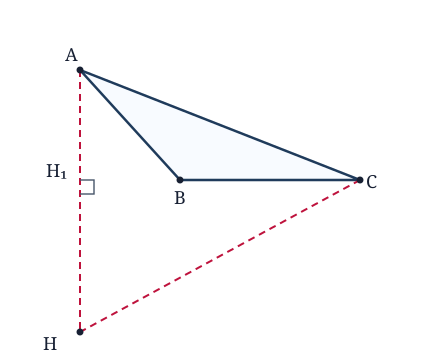

# 2025 AMC 12A Problem 11

## Problem
The orthocenter of a triangle is the concurrent intersection of the three (possibly extended) altitudes. What is the sum of the coordinates of the orthocenter of the triangle whose vertices are A(2,31), B(8,27), and C(18,27)?

$\textbf{(A)}~5\qquad\textbf{(B)}~17\qquad\textbf{(C)}~10+4\sqrt{17} +2\sqrt{13}\qquad\textbf{(D)}~\frac{113}{3}\qquad\textbf{(E)}~54$
## Solution 1
Since $BC$ is horizontal, the altitude from $A$ is the vertical line

$$
x=2.
$$

The slope of $AB$ is

$$
\frac{27-31}{8-2}=-\frac23,
$$

so the altitude from $C$ has slope $\frac32$. Its equation is

$$
y-27=\frac32(x-18).
$$

Substituting $x=2$ gives $y-27=-24$, so the orthocenter is $(2,3)$. The requested sum is

$$
2+3=\boxed{\textbf{(A)}\ 5}.
$$

*~dg6665  (edits for motivation by ~Logibyte)*
## Solution 2

Let the intersection of the heights and their corresponding sides be $H_1$ and $H_2$, respectively, and let the intersection of line $AH_1$ and $H_2B$ be E. Since $\angle EH_2A = \angle EH_1B = 90^{\circ}, \angle EBH_1 = 90^{\circ}- \angle BEH_1 = \angle EAH_2,$ we have

$\tan{\angle EBH_1} = \tan{\angle EAH_2} = \tan{\angle H_1AC} = \frac{CH_1}{AH_1} = 4$

Consequently,

$\frac{EH_1}{B_H1}=\frac{EH_1}{6}=\tan{\angle EBH_1}=4$

so $EH_1=24$, and the coordinates of E is exactly $(2, 31-4-24)=(2,3)$. Hence, the answer is $2+3=\boxed{\text{(A) }5}.$

*~Bloggish*
## Video Solution by Power Solve
https://www.youtube.com/watch?v=iqKA1sQ4Gwk
## Video Solution by SpreadTheMathLove
https://www.youtube.com/watch?v=dAeyV60Hu5c
