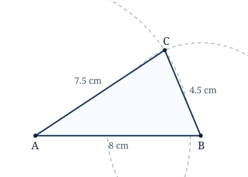
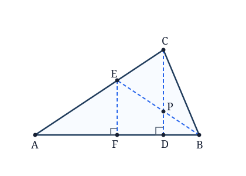

# 2025 AMC 12A Problem 16

> This problem is the same as [2025 AMC 10A #23](https://artofproblemsolving.com/wiki/index.php/2025_AMC_10A_Problems/Problem_23) and [2025 AMC 12A #16](https://artofproblemsolving.com/wiki/index.php/2025_AMC_12A_Problems/Problem_16).
## Problem
Triangle $\triangle ABC$ has side lengths AB = 80, BC = 45, and AC = 75. The bisector of $\angle B$ and the altitude to side $\overline{AB}$ intersect at point P. What is BP?

$\textbf{(A)}~18\qquad\textbf{(B)}~19\qquad\textbf{(C)}~20\qquad\textbf{(D)}~21\qquad\textbf{(E)}~22$
## Solution 1
Let $D$ be the foot of the altitude from $C$ to $\overline{AB}$. The right triangles $ACD$ and $BCD$ give

$$
\begin{aligned}
AC^2-BC^2&=AD^2-BD^2\\
&=(AD-BD)(AD+BD).
\end{aligned}
$$

Since $AD+BD=AB=80$, we obtain

$$
75^2-45^2=80(AD-BD),
$$

so $AD-BD=45$. Therefore,

$$
AD=\frac{125}{2},
\qquad
BD=\frac{35}{2}.
$$

Then

$$
CD^2=75^2-\left(\frac{125}{2}\right)^2=\frac{6875}{4},
\qquad
CD=\frac{25\sqrt{11}}{2}.
$$

Because $D$ lies on $\overline{AB}$, $BP$ bisects $\angle DBC$. Applying the Angle Bisector Theorem in $\triangle DBC$ gives

$$
\frac{DP}{PC}=\frac{BD}{BC}=\frac{35/2}{45}=\frac7{18}.
$$

As $DP+PC=CD$, it follows that

$$
DP=\frac7{25}CD=\frac{7\sqrt{11}}2.
$$

Finally, triangle $BDP$ is right at $D$, so

$$
\begin{aligned}
BP^2&=BD^2+DP^2\\
&=\left(\frac{35}{2}\right)^2+\left(\frac{7\sqrt{11}}{2}\right)^2\\
&=441.
\end{aligned}
$$

Hence

$$
BP=\boxed{\textbf{(D)}\ 21}.
$$

*~pigwash*
*~aldzandrtc(fixed logical jump)*
## Solution 2 (Law of Cosines)
Scale this down to a 9-15-16 triangle (we will multiply the result by 5 in the end).
Note that $9^2+16^2-18\cdot16\cdot\cos(\angle B) = 15^2,$ so 112 = 18 $\cdot 16 \cdot \cos(\angle B),$ which simplifies to $\frac{7}{18} = \cos(\angle B).$ Then $\cos(\frac{\angle B}{2}) = \sqrt{\frac{1+\frac{7}{18}}{2}} = \sqrt{\frac{25}{36}} = \frac{5}{6} (p$ositive root since the angle is acute). Therefore, we have $\frac{BD}{BP} = \frac{5}{6},$ assuming that D is the foot of the altitude.
There are many ways to proceed from here to find BD. Note that by Heron's formula, the area of the scaled-down triangle is $\sqrt{(20)(4)(5)(11)} = 20\sqrt{11}.$ Therefore, CD = $\frac{5}{2}\sqrt{11}.$ Using Pythagorean Theorem, we get BD= $\sqrt{81-\frac{25 \cdot 11}{4}} = \sqrt{\frac{324-275}{4}} = \frac{7}{2}.$ Therefore, we get $\frac{\frac{7}{2}}{BP} = \frac{5}{6},$ so BP = $\frac{21}{5},$ and we scale up by 5 to get $\boxed{\text{(D) }21}.$
*~ScoutViolet*
## Solution 3 (Stewarts)
Let the foot of the altitude coming from C on segment AB be D. Using the fact that CD is a common leg in right triangles $\triangle CDB$ and $\triangle CDA,$ we have 45^2 - BD^2 = 75^2 - (80-BD)^2. Expanding gives $45^2=75^2-80^2+160BD,$ so BD=$\frac{35}{2}.$
Let the foot of the angle bisector from B to AC be point E. Since BE is the angle bisector of $\angle CBA,$ we can use the angle bisector theorem. This gives $\frac{45}{CE}=\frac{80}{75-CE},$ so CE=27 and AE=$75-27=48$. Now we can use Stewart’s Theorem to find $\overline{BE}.$ We have $(48)(45)^2+(27)(80)^2=(27)(48)(75)+75BE^2. To$ simplify this expression, just divide by the greatest common divisor and solve from there. In the end, we get BE=48. Let BP=x, so PE=48-x. Draw the altitude from E down to AB. Let the foot of this altitude be F. Since EF || CD, we have $\triangle AFE \sim \triangle ADC.$ Hence, we can write the equation $\frac{48}{75}=\frac{AF}{\frac{125}{2}}.$ Solving gives AF=40, so FD=$\frac{125}{2}-40=\frac{45}{2}.$ Since PD || EF, we also have $\triangle BDP \sim \triangle BFE,$ so we have $\frac{x}{48}=\frac{\frac{35}{2}}{40}.$ Solving for x gives $\boxed{x=21}$ or $\boxed{\text{D}}.$

*~evanhliu2009*
## Solution 4 (Rulerbash)
Preface: When we have a problem as such, involving a simple diagram with minimal instructions, I use a method I named "rulerbash". Rulerbash should only be used in specific cases and as a last resort, mainly in the event of a time crunch or a difficult problem.

Start with the longest side, drawing a line with a length of 8\,$\text{cm} (AB).$ Then, using a compass, draw 2 circles centered around points A and B, 7.5\,$\text{cm}$ and 4.5\,$\text{cm}$ radiuses respectfully. At the point of intersection of these 2 circles, we have point C, completing a perfectly scaled drawing of $\triangle ABC. ($Note the circles are not necessary with a bit of trial and error with the side lengths, they simply offer a way to get it done first try).

After this, dropping the altitude to AB is simple with a ruler and careful placement, and angle bisector can be estimated quite accurately. (Note: Alternately, a compass can be used to accurately place the altitude and the bisector, which are both trivial constructions ~ZingiberiMaracandae)

After all of this, we can reuse our ruler and measure BP = 2.1\,$\text{cm},$ and using our scale of 80=8\,$\text{cm},$ our final answer is $\boxed{\text{(D) }21}.$

Other note: you kind of have to draw the angle bisector really accurately for this to work (I tried this)~ Sakura_kitty

*~shreyan.chethan (notes by curryswish)*
## Solution 5 (No Trig)
Let $D$ be the intersection of the altitude from $C$ to $AB$. To simplify calculations, divide all side lengths by $5$, and multiply by $5$ again at the end.
First, we use Heron’s Formula, $\sqrt{s(s-a)(s-b)(s-c)}$, to find the area. Let $[ABC]$ denote the area of $\triangle ABC$. By Heron’s Formula,
[ABC] = $\sqrt{20 \cdot 5 \cdot 4 \cdot 11} = 20\sqrt{11}.$
Next, we find the altitude $CD$ using the formula for the area of a triangle, $\tfrac{1}{2}bh = \text{area}$:

$$\frac{1}{2}(16)(CD) = 20\sqrt{11} \quad \Rightarrow \quad CD = \frac{5\sqrt{11}}{2}.$$

We can use the Pythagorean Theorem in $\triangle CDB$ to find $DB$:

$$DB^2 + \frac{25 \cdot 11}{4} = 81 \quad \Rightarrow \quad 4DB^2 + 275 = 324 \quad \Rightarrow \quad DB^2 = \frac{49}{4},$$

so $DB = \tfrac{7}{2}$.
Next, we use the Angle Bisector Theorem to find $PD$. Let $x = PC$ and $y = PD$. Since $x + y = \tfrac{5\sqrt{11}}{2}$, we have $x = \tfrac{5\sqrt{11}}{2} - y$.
From the given ratio,
$$\frac{9}{x} = \frac{7}{2y} \quad \Rightarrow \quad 18y = 7x.$$
Substituting $x = \tfrac{5\sqrt{11}}{2} - y$,

$$
18y = 7\left(\tfrac{5\sqrt{11}}{2} - y\right) \quad \Rightarrow \quad 25y = \tfrac{35\sqrt{11}}{2},
so $y = \tfrac{7\sqrt{11}}{10}$.
$$

Now, using the Pythagorean Theorem again to find $BP$:

$$\frac{49 \cdot 11}{100} + \frac{49}{4} = BP^2 \quad \Rightarrow \quad 100BP^2 = 49(11 + 25) = 49 \cdot 36,$$

so $BP = \tfrac{42}{10} = \tfrac{21}{5}.$

Finally, multiplying the side lengths by $5$ again gives $BP = 21.$, or $\boxed{\text{D}}.$

*~Voidling*
## Solution 6 (Similar Triangle)

Due to Angle Bisector Theorem

$$
\frac{CE}{AE} = \frac{BC}{BA} = \frac{45}{80} = \frac{9}{16}
CE = AC \times \frac{9}{25} = 27
AE = AC \times \frac{16}{25} = 48
$$

Notice that $\dfrac{CE}{CB} = \dfrac{CB}{CA} = \dfrac{3}{5}, \triangle CBE \sim \triangle CAB, \angle A = \angle CBE = \angle EBF,$ so $\triangle ABE$ is isosceles triangle, hence
$$AF = BF$$
Notice that AF:FD = AE:EC = 16:9, DB = FB - FD, then
AF:DB = 16:7

Notice that $\triangle PBD \sim \triangle EAF, PB = AE \times \dfrac{BD}{AF} = 48 \times \dfrac{7}{16} = \boxed{\text{(D) }21}.$

~[https://artofproblemsolving.com/wiki/index.php/User:Reda_mandymath 范_mandymath]
## Solution 7 (Pythagoras+angle bisector theorem)
Let CD be the altitude to side AB, and let E be the point of intersection of the angle bisector of $\angle B.$ Let P be the point of intersection of the angle bisector and the altitude.

By Pythagoras, CD^2=BC^2-BD^2=AC^2-AD^2

We let BD = x, so AD=80-x

Now we have

$$45^2-x^2=75^2-(80-x)^2$$

(This looks complicated, but we can see that we are going to have two $-x^2$ terms on both sides, so it cancels out)

Simplifying and rearranging gives us 80-$2x=45$, so $x=\frac{35}{2}$

Therefore, BD=$\frac{35}{2},$ and AD=$\frac{125}{2}.$ This gives us CD=$\frac{25}{2}\sqrt{11}$

Now, note that in triangle BDC, BP bisects $\angle DBC$

By the angle bisection theorem, we have
$$\frac{BD}{DP}=\frac{BC}{CP}$$

which gives us $\frac{DP}{CP}=\frac{BD}{BC}=\frac{7}{18}$

We have DP=$\frac{7}{25}*CD=\frac{7}{2}\sqrt{11}$ and  CP=$\frac{18}{25}*CD=\frac{18}{2}\sqrt{11}$

So

$$BP^2=BD*BC-DP*CP=\frac{35}{2}*45-\frac{7}{2}*\frac{18}{2}*11=441$$

Therefore, BP=21

(This is my first solution, pls point out any mistakes in math or LATEX). ~backtosq-1
### Alternative Ending to Solution 7
As an alternative ending equation to the solution above, I used the Pythagorean Theorem again, giving us: $BP^2=BD^2+PD^2=(\dfrac{35}{2})^2+(\dfrac{7\sqrt{11}}{2})^2=(\dfrac{1225}{4})+(\dfrac{539}{4})=\dfrac{1764}{4}=441$

Thus, BP=$\boxed{\textbf{(D)}~21}$

*~AH2025*
## Solution 8 (Pythagora's + Double Angle Identity)
Since all the lengths share a factor of 5, divide by 5 and multiply it back at the end for smaller numbers. Drop the altitude from vertex C to point D on AB. Then comparing the altitude by Pythagora's on both sides gives $9^2-x^2=15^2-(16-x)^2=15^2-16^2+32x-x^2=-31+32x-x^2$
Cancelling the $-x^2$ then solving gives us $x=\frac{112}{32}=\frac{7}{2}.$ Since $\triangle BDC$ is a right triangle with $\angle B=2\theta,$ we find $\cos(2\theta)=\frac{\frac{7}{2}}{9}=\frac{7}{18}.$

Let $\theta=\angle PBA=\angle PBC.$ Because $\angle B$ is opposite to the leg $9<15$ and not the hypotenuse, we must have that $2\theta$ is acute, likewise for $\theta.$ Hence, $\cos \theta>0.$

Thus, using cosine definition on $\triangle BDP$ and the double angle identity $\cos 2\theta=2\cos^2 \theta-1,$ we get

$$\cos \theta=\frac{7/2}{BP}=\sqrt{ \frac{1+\cos 2\theta}{2} }=\sqrt{ \frac{1+\frac{7}{18}}{2} }=\sqrt{ \frac{25}{36} }=\frac{5}{6}$$

Finally, solving for BP=$\frac{7}{2\cos\theta}=\frac{7}{2}\cdot \frac{6}{5}=\frac{21}{5}.$ Scaling back to the original diagram by 5 gives $\boxed{\textbf{(D)}~21}.$
## Solution 9(Law of Cosines+Angle Bisector Length Theorem)
Use Law of Cosines in $\triangle ABC$:
$$\cos B=\frac{80^2+45^2-75^2}{2\cdot 80\cdot 45}=\frac{7}{18}$$
Call E the intersection of the angle bisector of B and line segment AC, and let CD \perp AB, D=CD$\cap AB,$ therefore P=CD$\cap BE.$
In right triangle $\triangle BCD,$ use the definition of cosine:

$$\cos B=\frac{BD}{BC}=\frac{7}{18},\sin B=\sqrt{1-\cos^{2}B}=\frac{5\sqrt{11}}{18}$$

Therefore
$$BD=\frac{35}{2}, CD=\frac{25\sqrt{11}}{2}$$
Use Angle Bisector Theorem in $\triangle BCD$:
$$\frac{BD}{BC}=\frac{PD}{PC}=\frac{7}{18}$$
Therefore,
$$PD=\frac{7}{25}CF=\frac{7\sqrt{11}}{2}, PC=\frac{18}{25}CF=9\sqrt{11}$$
Use Angle Bisector length formula:
$$BP=\sqrt{BD\cdot BC-PD\cdot PC} =\boxed{\textbf{(D)} \ 21}$$
## Video Solution 1 by OmegaLearn.org
https://youtu.be/DI-q_-cYMVU
## Video Solution (In 3 Mins) (Really Easy)
https://youtu.be/nAimLnvSTwQ?si=85o8QuW5HbDldWdU ~ Pi Academy
## Video Solution by SpreadTheMathLove
https://www.youtube.com/watch?v=dAeyV60Hu5c
## Video Solution by Thinking Feet
https://youtu.be/pnKiumLyvXg
## See Also
