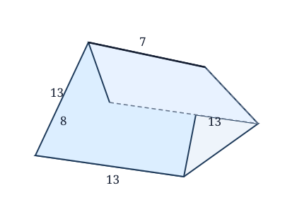

# 2025 AMC 12A Problem 20

## Problem
The base of the pentahedron shown below is a 13 $\times 8$ rectangle, and its lateral faces are two isosceles triangles with base of length 8 and congruent sides of length 13, and two isosceles trapezoids with bases of length 7 and 13 and nonparallel sides of length 13.

What is the volume of the pentahedron?

$\textbf{(A) } 416 \qquad \textbf{(B) } 520 \qquad \textbf{(C) } 528 \qquad \textbf{(D) } 676 \qquad \textbf{(E) } 832$
## Solution 1 (Split Into Three Parts)
In either triangular lateral face, the altitude to the side of length $8$ has length

$$
\sqrt{13^2-4^2}=\sqrt{153}.
$$

The top edge is centered over the base, so its horizontal offset from either end of the base is

$$
\frac{13-7}{2}=3.
$$

Thus the perpendicular height of the pentahedron is

$$
\sqrt{153-3^2}=12.
$$

Split the solid into a triangular prism whose triangular cross-section has base $7$ and height $12$, with length $8$, and two congruent pyramids. Their volumes are

$$
\frac12(7)(8)(12)=336
\qquad\text{and}\qquad
\frac13(3)(8)(12)=96,
$$

respectively. Hence the total volume is

$$
336+2(96)=528,
$$

so the answer is $\boxed{\textbf{(C)}\ 528}$.
## Solution 2
Note that the height is 12 from the previous method.
Note that as you go up, the length and width both decrease linearly and reach 0 at the end.

So the answer is $\int_0^{12} (8 - \tfrac{2}{3}$x)(13 - $\tfrac{1}{2}$x) $dx =\boxed{\textbf{(C) } 528}$

*~KapilTheAngel*
## Solution (3D Pythagoras)
Let H be the height of the solid. By 3D Pythagoras (recursion of 2D Pythagoras),

$$\left( \frac{8}{2} \right)^2+\left( \frac{13-7}{2} \right)^2+H^2=13^2=4^2+3^2+H^2=5^2+H^2$$

This gives the 5-12-13 triple, so H=12. Continue as in other solutions.

*~imosilver*
## Note
It just reminds about one of old aime problem {https://artofproblemsolving.com/wiki/index.php?title=1983_AIME_Problems/Problem_11 1983 AIME Problem 11}.
*~DRA777*
## Video Solution 1 by OmegaLearn.org
https://youtu.be/WwMDpnuZrJ4
## Video Solution by SpreadTheLove
https://www.youtube.com/watch?v=BadjXLma84M
