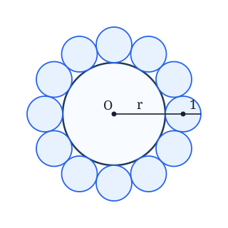
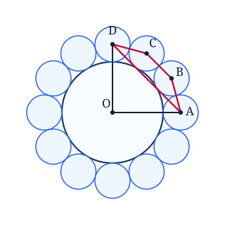

# 2025 AMC 12A Problem 24

## Problem
A circle of radius $r$ is surrounded by 12 circles of radius 1, externally tangent to the central circle and sequentially tangent to each other, as shown. Then $r$ can be written as $\sqrt{a}+\sqrt{b}+c$, where $a$, $b$, and $c$ are integers. What is $a+b+c$?

$\textbf{(A) } 3 \qquad \textbf{(B) } 5 \qquad \textbf{(C) } 7 \qquad \textbf{(D) } 9 \qquad \textbf{(E) } 11$
## Solution 1 (Sin 15)
Let $O$ be the center of the large circle, and let $A_1$ and $A_2$ be centers of adjacent unit circles. Then

$$
OA_1=OA_2=r+1,\qquad A_1A_2=2,
$$

and the central angle $\angle A_1OA_2$ is $360^\circ/12=30^\circ$. Bisecting this isosceles triangle produces a right triangle with hypotenuse $r+1$, side opposite the $15^\circ$ angle equal to $1$, and therefore

$$
\sin 15^\circ=\frac{1}{r+1}.
$$

Using

$$
\sin15^\circ=\frac{\sqrt6-\sqrt2}{4},
$$

we obtain

$$
r+1=\frac{4}{\sqrt6-\sqrt2}=\sqrt6+\sqrt2.
$$

Thus

$$
r=\sqrt6+\sqrt2-1.
$$

So $a=6$, $b=2$, and $c=-1$, giving

$$
a+b+c=6+2-1=7.
$$

The answer is $\boxed{\textbf{(C)}\ 7}$.
## Solution 2 (Law of Cosines Bash)
Let the center of the large circle be O and the centers of any two circles be A and B. Triangle OAB has side lengths $r+1, r+1$, 2, with the angle opposite 2 being $360/12 = 30$.

Using Law of Cosines, 2^2=AO^2+BO^2-2AOBO$\cos30.$ Plugging in the radius yields $2^2=(r+1)^2+(r+1)^2-2(r+1)^2\cdot\frac{\sqrt{3}}{2}.$ After solving for r and simplifying, we get $r=\sqrt6+\sqrt2-1.$ Therefore our answer is 7.

*~Kevin Wang*
### Worked Out Solution
4=($2-\sqrt{3})(r+1)^2.$ Divide both sides to get $\frac{4}{2-\sqrt{3}}=(r+1)^2.$ Rationalize and expand to get $8+4\sqrt{3}=r^2+2$r+1. Then r^2+$2r$+(-7-$4\sqrt{3})=0.$ Use the quadratic formula to get $r=\frac{-2+\sqrt{4+28+16\sqrt{3}}}{2},$ or $r=-1+\sqrt{8+4\sqrt{3}} ($Note: We only take the plus instead of plus-minus because r must be positive). Clearly c=-1, and then we need to find some a and b such that $\sqrt{a} + \sqrt{b} = \sqrt{8+4\sqrt{3}}.$ If we square both sides, $a+b+2\sqrt{ab} = 8+4\sqrt{3},$ so a+$b=8$. Plug in our previously found values to find a+b+$c=8$+(-1). Therefore our answer is 7.

*~Samuel and Jungbin*

$\textbf{Remark}$

We could've also noticed that $\sqrt{2-\sqrt{3}} = \sqrt{\frac{1}{2}\cdot(4-2\sqrt{3})} = \frac{1}{\sqrt{2}}*\sqrt{3-2\sqrt{3}+1} = \frac{1}{\sqrt{2}}*(\sqrt{3}-1),$ and therefore directly gotten $r+1=\sqrt{\frac{4}{2-\sqrt{3}}} = \frac{2}{\frac{1}{\sqrt{2}}*(\sqrt{3}-1)} = \frac{2\sqrt{2}}{\sqrt{3}-1}$ and solved from there.
## Solution 3 (Easy Geo Method)
We connect the centers of the smaller circles at $0^\circ$ and $90^\circ$ as follows:

Note that connecting the centers of the 12 smaller circles forms a regular 12-gon. A regular 12-gon has angles

$$\frac{10\cdot 180}{12} = 150^\circ,$$

so $\angle OAB = \angle ODC = 75^\circ.$ Furthermore, since OA=OD and $\angle AOD = 90^\circ,$ we have $\angle OAD = 45^\circ,$ so $\angle DAB = 30^\circ.$ Next, we drop the perpendiculars from B and C to AD. This creates a 1 $\times 2$ rectangle and two 30-60-90 triangles. Thus,

$$AD = (r+1)\sqrt{2} = 2+2\sqrt{3},$$

and manipulating yields

$$r = -1 + \sqrt{2}+\sqrt{6},$$

so the desired answer is -1+2+6 = $\boxed{\text{(C) } 7.}$

P.S. I posted the asymptote code here. Anyone that wishes to use it can steal~ :)

*~ABC09090927*
## Video Solution 1 by OmegaLearn.org
https://youtu.be/nR67IIw_kgg
## Video Solution 2 by SpreadTheMathLove
https://www.youtube.com/watch?v=dAeyV60Hu5c
## Video Solution 3 by VHS Math Mentorship
https://youtu.be/jtgG1OY-rDs?si=Z50z59yaKjHCUhEw
