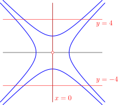

# 2026 AMC 12A Problem 9

## Problem
How many ordered pairs $(x,y)$ of real numbers satisfy the following system of equations?
 

$$
|x^2-y^2|=4\\
\frac{16x}y=xy
$$

$\textbf{(A)}\   2  \qquad 	\textbf{(B)}\   4  \qquad 	\textbf{(C)}\   6  \qquad 	\textbf{(D)}\   8  \qquad 	\textbf{(E)}\   10$

## Solution 1 (Algebra)
We get that $\frac{16x}y=xy\implies 16x=xy^2\implies xy^2-16x=0\implies x(y^2-16)=0$. So we have 3 cases to test out.
*If $x=0$, then we have $|-y^2|=|y^2|=4$. Since $y^2\ge 0$ by the Trivial Inequality, we must have $y^2=4$ for $y=\pm 2$. This accounts for 2 cases.
*If $y^2-16=0$, we have 2 sub-cases. For the positive case of $y=4$, we obtain $|x^2-16|=4\implies x^2-16=\pm 4\implies x^2=16\pm 4=12, 20$ (if the first step is not clear, $|x|=c$ means that $x=c$ or $x=-c$, which is inherently $\pm c$). This provides 4 more cases (a negative and positive $x$ for both numbers). Finally, when $y=-4$ we have $|x^2-16|=4$ which yields 4 more cases.

Hence we have a total of $2+4+4=\boxed{10\hspace{1mm}\textbf{(E)}}$ ordered pairs.

~singularity1

## Solution 2 (geometric interpretation)

Note that $\lvert x^2 - y^2 \rvert = 4$ plots two hyperbolae in the plane with vertices $(0, \pm 2)$ and $(\pm 2, 0)$.

Note that $\frac{16x}{y} = xy$ has solution set $x = 0$ or $y \in \{\pm 4\}$ but not $y = 0$ (not a concern).

The vertical line $x = 0$ has two points of intersection with the hyperbolae, and the horizontal lines $y \in \{\pm 4\}$ have $4$ points of intersection each with the hyperbolae.

Hence, the number of real solutions is $2 + 4 + 4 = \boxed{\textbf{(E) }10}$.

~Mqnic_ ~ssingh11(diagram)

## Solution 3 (Logical Cheese)
Notice that after dividing both sides of the second equation by $x$, we exclude $x=0$ and have two resulting solutions for $y$. Since there are two solutions for $y$ but only one solution for $y^2$, logically, there are two solutions for $x$ under each $y$. Adding back $x=0$ gives us a total of $1+2*2=5$ solutions. Yet, since $x^2 - y^2$ is under an absolute value, we have twice the number of solutions and thus we have $\boxed{\textbf{(E) }10}$.

~ Aeioujyot

## Video Solution 1 by SpreadTheMathLove
https://www.youtube.com/watch?v=Jc2s489VKIQ

## Video Solution 2 by MathIsFun
https://youtu.be/JRWnRtZNW9o?si=fiKO53hLclLR4N-A&t=1360
