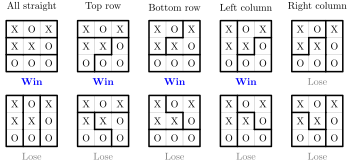

# 2026 AMC 12A Problem 16

> This problem is the same as [2026 AMC 10A #21](https://artofproblemsolving.com/wiki/index.php/2026_AMC_10A_Problems/Problem_21) and [2026 AMC 12A #16](https://artofproblemsolving.com/wiki/index.php/2026_AMC_12A_Problems/Problem_16).

## Problem
Gerry is playing the Triples Game. Her task is to partition the $3\times 3$ grid of squares shown on the left into three sections, each containing three adjoining squares. (Three squares are adjoining if each shares an edge with at least one of the other two.) One point will be awarded for each section containing more $\mathsf{X}$'s than $\mathsf{O}$'s. Shown on the right is a sample partition that will earn one point in total. A partition that earns two or more points will win the game. What fraction of the possible partitions of this particular grid will result in a win for Gerry?

$\textbf{(A)}~\frac{3}{10} \qquad \textbf{(B)}~\frac{1}{3} \qquad \textbf{(C)}~\frac{2}{5} \qquad \textbf{(D)}~\frac{4}{9} \qquad \textbf{(E)}~\frac{1}{2}$

## Solution 1
There are four corner squares but only three sections, so some section contains two corners. A connected section of three squares containing two corners must be a complete outer row or column.

Removing it leaves a $2\times3$ rectangle, which splits into either two straight sections or two L-shaped sections. There are $2$ all-straight partitions (rows or columns). Otherwise, choose the single straight section on one of the $4$ sides, then split the remaining rectangle into two L-shapes in $2$ ways. Thus there are

$$
2+4\cdot2=10
$$

partitions in total.

Since there are only $4$ X's, a win requires exactly $2$ X's in each of two sections. All $10$ partitions are shown below; exactly $4$ win.

Therefore, the requested fraction is

$$
\frac{4}{10}=\boxed{\frac25},
$$

We choose $\boxed{\textbf{(C)}}$.

~SZ624
~hellokindsir

## Solution 2
Consider the section that includes the bottom-right square. Note that it will always have two O's, so whatever section contains it will be invalid. We casework over all the possible sections, and look at how we can split the remaining 6 tiles for each. This makes it easier to count, as now both the other sections must have more X's than O's to win, and we are sure that we have covered all the cases. Proceed as Solution 1.

~Moonwatcher22

## Solution 3 (similar to Solution 2)
Consider the section that includes the bottom-right square. Note that it will always have two O's.  If you really want to know how you can immediately get 10, you can split it into casework that either there are 3 rows which satisfy this, one row which satisfies this (and the rest are weird L's), three columns which satisfy this, and one column which satisfies this. To create three rows and three columns, it's obviously just 1 for both of them, which is 2 in total. For the L's case the one row can either be the first row or the third row by logic and the L's can have 2 different positions to be in to satisfy the 2x3 remaining rectangle. Therefore it is 2x2, which is 4, and by columns, the answer remains the same. Therefore, the number of permutations in total is 10. It's better to see the answer choices to make sure we're correct. the 9 in 4/9 is awfully close to our 10, but under further inspection none of our cases intersect. That too, we got 4 for both of them, meaning we eventually get $\boxed{\textbf{(C)}}$. Proceed as above.

~apmathematician

## Solution 4
Consider the section that includes the bottom-right square. Note that it will always have two O's, so whatever section contains it will be invalid. We casework over all the possible sections, and look at how we can split the remaining 6 tiles for each. This makes it easier to count, as now both the other sections must have more X's than O's to win, and we are sure that we have covered all the cases. Proceed as Solution 1.

~Moonwatcher22

GoldemGem4848: solution 2 achieved mitosis

## Solution 5
First, we count the number of total partitions. Consider the "$l$" shape formed by three squares. We see that if we fix any "$l$" that contains the center square, the rest is uniquely determined. There are 8 such "$l$"s, but we have to also account for the case where there are 3 vertical lines and 3 horizontal lines. These account for 10 partitions in total.

Now, we count the number of winning partitions. Let the square directly to the left of the center square be called the penguin square.

Case 1: Center and penguin square are together in a winning partition. We can see it either has to be horizontal or containing the bottom-left square, and the rest are uniquely determined, for a total of 2 cases.

Case 2: Center and penguin square are disjoint in a partition. We see that the center square has to be in the partition with the top-right square, and then the rest are uniquely determined, for a total of 2 cases.

$\frac{2+2}{10} = \boxed{\textbf{(C)}~\frac{2}{5}}$.

~notvalid, ZichenXu2013, nuthuts, math class, scratch paper, penguins, whiteboard, marker, explanation, voice, vocal chords, brain, abstract thinking, atoms, gluons, teacher, food for thought, parents, money, school, earth, solar system, milky way galaxy, observable universe, Dimension #17989908 (ours), icecream, electrons valence, coffee on test day, books, murals, windows, sugar, mice, glutinous rice balls, electricity, phones, watches, burgers, pizzas, creepypastas, and uhhh, add anything if I missed anything. HOLY NPESTA CREEPY PASTA REFERENCE

## Solution 6
Consider the section that includes the bottom-right square. Note that it will always have two O's, so whatever section contains it will be invalid. We casework over all the possible sections, and look at how we can split the remaining 6 tiles for each. This makes it easier to count, as now both the other sections must have more X's than O's to win, and we are sure that we have covered all the cases. Proceed as Solution 1.
~Moonwatcher22

## Solution 7
For each section that gains a point, it must have atleast 2 X's as if it only has maximum one X, it will have at least 2 O's and not count. So that means (a) max 2 points can be gained and (b) there must be one section with only O's as otherwise there are only maximum 3 X's and only one point can be gained. There are 2 ways this can be achieved: either you use the bottom row of O's and then you have 3 ways, either 3 rows, or the bottom row and 2 L-shapes which can be oriented in 2 ways. The 3 rows and one orientation of the L-shapes work, so we get 2 cases. The other case is the bottom L-shape of 3 O's and any of the 2 ways from here works. So in total there are 4 ways that work, and to count the total ways, we have 2 ways of only 3 rows or 3 columns, and then we have the ones with the L-shapes: one line in any direction gives 2 orientations of the L-shapes and there are 2 rows and 2 columns that allow L-shapes, which makes $2\cdot4=8$ ways so in total we have $2+8=10$ ways so our answer is $\frac{4}{10}$ which simplifies to $\boxed{\text{(C) }\frac{2}{5}}$.
~keyo

## Video Solution 1 by MadMath
https://youtu.be/glAPxQJFYfo

## Video Solution 2 by SpreadTheMathLove
https://www.youtube.com/watch?v=Jc2s489VKIQ
