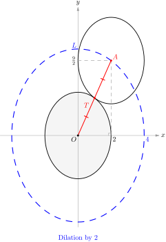
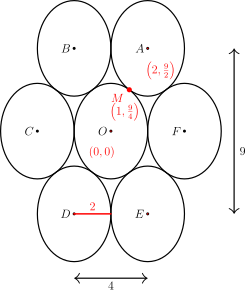
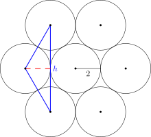

# 2026 AMC 12A Problem 17

> This problem is the same as [2026 AMC 10A #22](https://artofproblemsolving.com/wiki/index.php/2026_AMC_10A_Problems/Problem_22) and [2026 AMC 12A #17](https://artofproblemsolving.com/wiki/index.php/2026_AMC_12A_Problems/Problem_17).

## Problem
An engineer is designing a closely packed field of $7$ wind turbines for electricity production. Each turbine, whose center is marked by a labeled dot in the figure, occupies one of $7$ congruent elliptical regions. Turbines in the same row have centers that are $4$ units apart, and turbines in the same column have centers that are $9$ units apart, as shown in the figure below

The major axis of each ellipse is $m\sqrt{p}$, where $m$ and $p$ are positive integers and $p$ is not divisible by the square of any prime. What is $m + p$?
$\textbf{(A)}~6 \qquad \textbf{(B)}~8 \qquad \textbf{(C)}~9 \qquad \textbf{(D)}~10 \qquad \textbf{(E)}~12$

## Solution 1
Let $L$ be the major axis length. Each ellipse has horizontal semiaxis $2$, and adjacent rows are $\frac{9}{2}$ apart. Place the middle center at $O=(0,0)$; then the upper-right center is $A=(2,\frac{9}{2})$.

Let $T$ be their point of tangency. A half-turn about the midpoint of $OA$ swaps the two ellipses, so it fixes their unique common point $T$. Thus $T$ is the midpoint of $OA$.

Dilating the middle ellipse by a factor of $2$ about $O$ sends $T$ to $A$. The resulting ellipse, drawn with a blue dashed curve, has semiaxes $4$ and $L$.

Since $A=(2,\frac{9}{2})$ lies on this ellipse,

$$
\frac{2^2}{4^2}+\frac{(9/2)^2}{L^2}=1
\quad\Longrightarrow\quad
L^2=27
\quad\Longrightarrow\quad
L=3\sqrt3.
$$

Therefore $m+p=3+3=\boxed{\text{(A)}\ 6}$.

## Solution 2

Let $O$ be the origin, at $(0,0)$. Also, let the major axis of an ellipse, which is what we're looking for, be $a$. Then the equation of the ellipse centered at $O$ is

$$
\frac{x^2}{4} + \frac{y^2}{(\frac{a}{2})^2}=1.
$$

Notice that if we could find one pair that lies on the ellipse, we could plug it into the equation and solve for $a$.

Let's focus on the ellipse centered at $A$. It has coordinates $(2, \frac{9}{2})$. Notice that the midpoint of $O$ and $A$ ($M$ in the above diagram) lies on the central ellipse. The coordinates of that midpoint are $(1, \frac94)$ (by the midpoint formula). We now have a point that lies on the ellipse. Plugging it in, we get

$$
\frac{1^2}{4} + \frac{(\frac94)^2}{(\frac{a}{2})^2}=1.
$$

$$
a^2 + 81 = 4a^2
$$

$$
a^2 = 27.
$$

Thus, $a = 3\sqrt3$, and our answer is $\boxed{\text{(A) }6}.$

~lprado

Hi, would you want a diagram added to your solution?

Hi, yes.

Hi, I have added the diagram (though i'm not the person who asked the original question) ~sujoybec51

## Solution 3 (Easiest)
We can view the given figure of ellipses as a vertical stretch of this figure of seven tangent circles of radius $2$ by some scale factor: 

By connecting three centers as shown, we create an isosceles triangle with equal legs of length $4$ and deduce $h=4\sqrt3.$ Since this vertical distance was given as $9$ in the problem, we conclude that the stretch factor between this diagram and the given one is $\frac{9}{4\sqrt3}.$ 

Thus, the major axis of one of the ellipses is simply the diameter of one of these circles multiplied by the stretch factor, or $m\sqrt{p}=(4)\left(\frac{9}{4\sqrt3}\right)=3\sqrt{3}\implies m+n=\boxed{\text{(A) } 6}$ 

~Neoronean 

~Tacos_are_yummy_1 ($\LaTeX$)

~ Bnn81351 (very minor $\LaTeX$ edit)

## Solution 4 (Ruler Cheese)
You can ruler bash. Very risky but works. 
Edit: By ruler, we get the length of one major axis to be around $5.125$, which is very close to $3 \sqrt3$, so $3+3=$   $\boxed{\text{(A) }6}.$

It would be so orz if someone actually got the answer by this :sob:

~Jelly0607
~N0lan (made edit and LaTeX)

### Note
Yay, a fellow cheese enthusiast!

A way to justify the radical approximation 5.125 is as follows:

Due to the hexagonal nature (and rightfully so, to maximize electricity, "hexagons are the bestagons") of the turbines, the simplified number under the radical is almost certainly $p=3$. From there, you can 3 from the answer choices to obtain $m$: $

$$
\textbf{(A)}~m=3 \qquad \textbf{(B)}~m=4 \qquad \textbf{(C)}~m=6 \qquad \textbf{(D)}~m=7 \qquad \textbf{(E)}~m=9
$$

Also, here are some calculations to show the diagram is intended to be to scale for the ruler cheese:

You can verify that the ratio of the small to the long line segment on your test sheet is indeed approximately 4:9. For example, the measurement on my test sheet, to the rounding error in my 0.1 cm ruler, is 1.4 cm:3.4 cm; using the same ruler, the measurement on the diagram on this webpage above at 100% zoom is 2.7 cm: 6.7 cm.

Since the scale on both axes is similar to the given values with negligible error, we conclude the graph is almost certainly to scale.

~megaboy6679

## Solution 5 (Transformations)
We apply the transformation to the diagram 

$$
T(x, y) \implies \left( \frac{x}{a}, \frac{y}{b} \right)
$$

So that the center turbine maps to a unit circle.

Since each of the outer circles are contacting each other and the center circle, hexagon ABCDEF is a regular hexagon with a side length of 2. On the original hexagon, the distance $\overline{AE}$ is 9. Under $T(x, y)$, the distance AE becomes $\frac{9}{a}$.
The distance between AE is also equal to 

$\overline{AE}= 2*2\sin(60) = 2\sqrt{3}$. 

Therefore, 

$\frac{9}{a} = 2\sqrt{3} \implies a= \frac{3\sqrt{3}}{2}$ 

Hence the major axis is $2a = 3\sqrt{3}$. The answer is $3 + 3 = \boxed{\text{(A) }6}.$

~Sharkbluehorse

## Video Solution 1 by MadMath
https://youtu.be/xDBib-6lENo

## Video Solution 2 by SpreadTheMathLove
https://www.youtube.com/watch?v=Jc2s489VKIQ
## Video Solution 3
https://youtu.be/sOCkYWCu-6c
