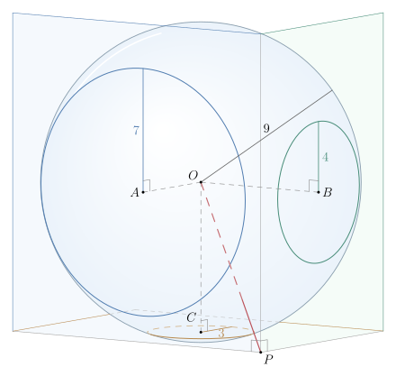
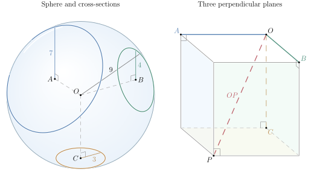

# 2026 AMC 12A Problem 18

## Problem
A sphere with center $O$ and radius $9$ cuts three mutually perpendicular planes that meet at point $P$, forming three circular cross-sections on these planes, which have radii $7, 4,$ and $3$. What is $OP$?

$\textbf{(A)}~10\qquad\textbf{(B)}~11\qquad\textbf{(C)}~12\qquad\textbf{(D)}~13\qquad\textbf{(E)}~14$

## Diagram

~SZ624

## Solution 1
Every point on the three cross-sections also lies on the sphere. Therefore, each of those points is $9$ away from $O$ from the definition of the sphere. Let the centers of the circles with radii $7$, $4$, and $3$ be $A$, $B$, and $C$, respectively. By the Pythagorean Theorem, 

$$
OA = \sqrt{9^2 - 7^2} = \sqrt{32}.
$$

$$
OB = \sqrt{9^2 - 4^2} = \sqrt{65}.
$$

$$
OC = \sqrt{9^2 - 3^2} = \sqrt{72}.
$$

Assume that the planes are the $xy$ plane, the $xz$ plane, and the $yz$ plane, all of which are mutually perpendicular. The distance from an arbitrary point to each plane is equal to the $z$, $y$, and $z$ coordinates of that point. Observe that $OA$, $OB$, and $OC$ are the distances from $O$ to each of the planes. Then the distance between $O$ and the origin, or point $P$, is equal to $\sqrt{x^2+y^2+z^2}$, where $x$, $y$, and $z$ are the coordinates of $O$. By our reasoning above, the coordinates of $O$ are $(\sqrt{32},\sqrt{65},\sqrt{72})$. Plugging in, we find that 

$$
OP = \sqrt{(\sqrt{32})^2+(\sqrt{65})^2+(\sqrt{72})^2} = \sqrt{32+65+72} = \sqrt{169} = \boxed{13},
$$

so the answer is $\boxed{(D)\, 13}$.
~gb1falcon
