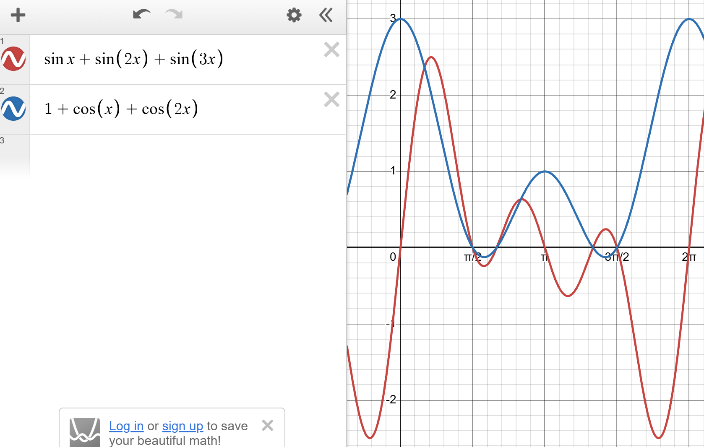

# 2026 AMC 12A Problem 19

## Problem
How many values of $x$ between $0$ and $2\pi$, inclusive, satisfy the equation

$$
\sin x +\sin(2x)+\sin(3x) = 1+\cos x+\cos(2x)?
$$

$\textbf{(A) } 1\qquad\textbf{(B) } 2\qquad\textbf{(C) } 4\qquad\textbf{(D) } 6\qquad\textbf{(E) } 8$

## Solution 1
Use the identity $\sin(3x)=3\sin x-4\sin^3 x$ as well as the double-angle identities to get

$$
4\sin x-4\sin^3x +2\sin x\cos x=1+\cos x+2\cos^2x-1=\cos x+2\cos^2 x
$$

We know that $4\sin x-4\sin^3x=4\sin x(1-\sin^2x)=4\sin x \cos^2 x$. Therefore,

$$
4\sin x\cos^2 x+2\sin x\cos x=\cos x+2\cos^2 x
$$

We may then extract $\cos x=0$. Otherwise, dividing by $\cos x$ yields

$$
4\sin x\cos x+2\sin x=1+2\cos x\implies (2\cos x+1)(2\sin x-1)=0
$$

which implies that $\cos x=-\frac{1}{2}$ or $\sin x=\frac{1}{2}$. All three sets of solutions yield exactly two solutions each, all unique, hence there are $6$ total solutions, or $\boxed{\textbf{(D)}}$.

~ [eevee9406](https://artofproblemsolving.com/wiki/index.php/User:Eevee9406)

## Solution (Complex Numbers)
Let $z=e^{ix}$ and $S=1+z+z^2$. The given equation is

$$
\operatorname{Im}(zS)=\operatorname{Re}(S).
$$

Since $|z|=1$, we have $\overline S=S/z^2$ and $\overline{zS}=S/z^3$. Hence

$$
\frac{zS-S/z^3}{2i}=\frac{S+S/z^2}{2}.
$$

Multiplying by $2iz^3$ and factoring gives

$$
0=S\bigl(z^4-1-iz(z^2+1)\bigr)
=(z^2+z+1)(z^2+1)(z^2-iz-1).
$$

The three factors give

$$
z=\frac{-1\pm i\sqrt3}{2},
\qquad
z=\pm i,
\qquad
z=\frac{i\pm\sqrt3}{2}.
$$

These are six distinct points on the unit circle, none equal to $1$. Each therefore gives exactly one $x$ in $[0,2\pi]$, so the answer is $\boxed{6}$, we choose $\boxed{\textbf{(D)}}$.

~SZ624

## Solution 2
We can use the sum-to-product identity 

$$
\sin(a)+\sin(b)=2\sin\left(\frac{a+b}2\right)\cos\left(\frac{a-b}2\right)
$$

 on $\sin(x)+\sin(3x)$ to obtain $2\sin(2x)\cos(x)$ . Hence we have 

$$
2\sin(2x)\cos(x)+\sin(2x)=1+\cos(x)+\cos(2x)\implies \\ 
\sin(2x)(2\cos(x)+1)=2\cos^2(x)+\cos(x)=\cos(x)(2\cos(x)+1).
$$

 At this point, we can see that the solutions to $2\cos(x)+1=0$ satisfy this equation, which will yield 2 solutions on $[0, 2\pi]$. Now we cancel and get $\sin(2x)=\cos(x)\implies 2\sin(x)\cos(x)=\cos(x)$. So the solutions to $\cos(x)=0$ also satisfy our original equation, which yields another 2 solutions. Finally, $2\sin(x)=1$ yields another 2 solutions, for a total of $2+2+2=\boxed{6\hspace{1mm}\textbf{(D)}}$ solutions.

~singularity1

## Solution 3 (Intuition)
Write $\sin x = \sin(2x - x)$ and $\sin 3x = \sin(2x + x)$. Expanding gives

$$
\sin(2x - x) = \sin 2x\cos x - \cos 2x\sin x,
$$

$$
\sin(2x + x) = \sin 2x\cos x + \cos 2x\sin x.
$$

Adding this has the $\cos 2x\sin x$ terms cancel, so

$$
\sin x + \sin 3x = 2\sin 2x\cos x.
$$

The LHS therefore becomes

$$
\sin 2x + 2\sin 2x\cos x = \sin 2x\,(1 + 2\cos x).
$$

For the RHS, use $\cos 2x = 2\cos^2 x - 1$ to get

$$
1 + \cos x + 2\cos^2 x - 1 = \cos x\,(1 + 2\cos x).
$$

Setting the two sides equal and factoring out $1 + 2\cos x$ gives

$$
(1 + 2\cos x)(\sin 2x - \cos x) = 0.
$$

Since 
$\sin 2x - \cos x = 2\sin x\cos x - \cos x = \cos x\,(2\sin x - 1)$, 
the equation factors out into

$$
(1 + 2\cos x)\cos x\,(2\sin x - 1) = 0.
$$

Now all that’s left is to count solutions on $[0, 2\pi]$:
- $\cos x = -\tfrac{1}{2}$ gives $x = \tfrac{2\pi}{3}, \tfrac{4\pi}{3}$.
- $\cos x = 0$ gives $x = \tfrac{\pi}{2}, \tfrac{3\pi}{2}$.
- $\sin x = \tfrac{1}{2}$ gives $x = \tfrac{\pi}{6}, \tfrac{5\pi}{6}$.

Thus the answer is $\boxed{\textbf{(D)}~6}$.

~ Aeioujyot

## Solution 4 (Graphing)

Instead of using identities or other tricks, we can simply graph the equations $y=\sin x+\sin\left(2x\right)+\sin\left(3x\right)$ and $y=1+\cos\left(x\right)+\cos\left(2x\right)$. After counting the intersections  we get the answer $\boxed{\textbf{(D)}~6}$.

~ IcySea123

Note: Although we don't have Desmos on the test, graphing it using every theta value we know trig for ex: ($\frac{\pi}{6}$, $\frac{\pi}{3}$, is good enough for a reasonably accurate graph. ~AncientKarnivore
