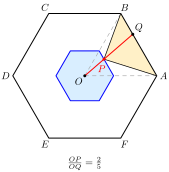

# 2026 AMC 12A Problem 21

## Problem
Six dogs find a large cookie in the shape of a regular hexagon $ABCDEF$. To divide the cookie, the dogs agree to choose a point $P$ uniformly at random in the interior of the hexagon. The dogs will then cut out the segments $\overline{PA}$, $\overline{PB}$, $\overline{PC}$, $\overline{PD}$, $\overline{PE}$, and $\overline{PF}$, dividing the cookie into six triangles, one for each dog. A dog will be happy if and only if its piece has at least $\frac{1}{10}$ of the total area of the hexagon. What is the probability that all six dogs will be happy?

$\textbf{(A) }\dfrac{\sqrt3}{50}\qquad\textbf{(B) }\dfrac{1}{25}\qquad\textbf{(C) }\dfrac{3\sqrt3}{50}\qquad\textbf{(D) }\dfrac{4}{25}\qquad\textbf{(E) }\dfrac25$

## Solution 1
Let $O$ be the center and $S$ the total area. Write $[XYZ]$ for the area of $\triangle XYZ$. Extend $OP$ to meet the boundary at $Q$, and set $t=\frac{OP}{OQ}$.

With a fixed base, a triangle's area changes linearly as its vertex moves along a line. Thus, for every side $UV$,

$$
[PUV]=(1-t)[OUV]+t[QUV]
=(1-t)\frac S6+t[QUV]
\ge(1-t)\frac S6.
$$

Equality holds for the side containing $Q$, so the smallest piece has area exactly $(1-t)S/6$. Therefore, all six dogs are happy precisely when

$$
\frac{(1-t)S}{6}\ge\frac S{10}
\quad\Longleftrightarrow\quad
t\le\frac25.
$$

Along every ray from $O$, the allowed points occupy the first $\frac{2}{5}$ of the distance to the boundary. Hence the allowed region is the blue hexagon below, a copy of the original scaled by $\frac{2}{5}$ about $O$.

Since $P$ is chosen uniformly, the probability equals the area ratio:

$$
\left(\frac25\right)^2=\boxed{\frac4{25}},
$$

We choose $\boxed{\textbf{(D)}}$.

~SZ624

## Solution 2
We may assume WLOG that the hexagon has side length $1$. The area of the hexagon is then

$$
\frac{\sqrt{3}}{4}\cdot 6=\frac{3\sqrt{3}}{2}
$$

so the area that each dog must get in order to be happy is $\frac{3\sqrt{3}}{20}$. This implies that the distance $h$ from $P$ to each side, or the height of the triangle of each dog, must satisfy

$$
\frac{1}{2}\cdot 1\cdot h\ge \frac{3\sqrt{3}}{20}\implies h\ge \frac{3\sqrt{3}}{10}
$$

By symmetry, the area produced that yields a valid configuration is a smaller hexagon. The distance between opposite sides of the original hexagon can be found to be $\sqrt{3}$, so the distance between opposite sides of the new hexagon is

$$
\sqrt{3}-2\cdot \frac{3\sqrt{3}}{10}=\frac{2\sqrt{3}}{5}
$$

Therefore, the ratio between side lengths of the smaller hexagon to the larger hexagon is

$$
\frac{\frac{2\sqrt{3}}{5}}{\sqrt{3}}=\frac{2}{5}
$$

since the ratio of the distances between opposite sides is the same as the ratio of the lengths of the sides. Therefore, the ratio of the areas, which is precisely the fraction of the original hexagon that is valid, or the answer, is $\left(\frac{2}{5}\right)^2=\frac{4}{25}$, which is $\boxed{\textbf{(D)}}$.

Other Path you can take: 
Alternatively, instead of using the total distance between opposite sides, we can analyze the region from the center using the apothem. 

Let the distances from the interior point $P$ to the sides of the hexagon be $h_1, h_2, \dots, h_6$. Since each base has a length of $1$, the total area of the hexagon is the sum of the areas of these six triangles:

$$
\sum_{k=1}^6 \frac{1}{2}h_k = \frac{3\sqrt{3}}{2} \implies \sum_{k=1}^6 h_k = 3\sqrt{3}
$$

As established above, each height must satisfy $h_k \ge \frac{3\sqrt{3}}{10}$. This condition bounds $P$ within a smaller, concentric regular hexagon shifted inward by a distance of $\frac{3\sqrt{3}}{10}$ from each side. 

Since the apothem of the original unit hexagon is $a = \frac{\sqrt{3}}{2}$, the apothem of this smaller valid region is:

$$
a_{\text{small}} = a - \frac{3\sqrt{3}}{10} = \frac{\sqrt{3}}{2} - \frac{3\sqrt{3}}{10} = \frac{\sqrt{3}}{5}
$$

Using the ratio of their apothems, the ratio of their areas (and thus the probability) is:

$$
\text{Probability} = \left( \frac{a_{\text{small}}}{a} \right)^2 = \left( \frac{\frac{\sqrt{3}}{5}}{\frac{\sqrt{3}}{2}} \right)^2 = \left( \frac{2}{5} \right)^2 = \frac{4}{25}
$$

~ [eevee9406](https://artofproblemsolving.com/wiki/index.php/User:Eevee9406)
Other path: ~ [akalkunte121](https://artofproblemsolving.com/wiki/index.php/User:akalkunte121)
