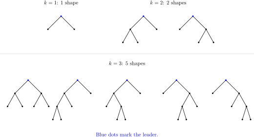

# 2026 AMC 12A Problem 22

## Problem
A flock of $8$ birds is flying in formation, led by a single leader bird, which has exactly $2$ followers immediately behind. Each non-leader bird follows exactly one bird, and has $0,1,$ or $2$ followers immediately behind. Two possible formations are shown in the figure below. (When a bird has two followers, swapping its left and right subflocks can produce a different formation, as shown in the figure).

What is the total number of possible formations?

$\textbf{(A) } 48\qquad\textbf{(B) } 52\qquad\textbf{(C) } 76\qquad\textbf{(D) } 132\qquad\textbf{(E) } 196$

## Solution 1
We temporarily remove every bird with exactly one follower, connecting its predecessor directly to its follower. This preserves the left-right order of every branch.

If $k$ birds remain with two followers, the reduced formation has $2k$ links and hence $2k+1$ birds. Thus $k=1,2,3$. There are respectively $1,2,5$ reduced shapes, shown below.

For $k=3$, the other two branching birds lie on opposite sides of the leader in one way, or on the same side in $2\cdot2$ ways.

For each reduced shape, we reinsert the $7-2k$ removed birds along its $2k$ links. Choosing how many to place on each link is a stars-and-bars problem, giving

$$
\binom{(7-2k)+(2k)-1}{2k-1}=\binom{6}{2k-1}
$$

possibilities. No birds may be inserted above the leader, which must still have two immediate followers. Each original formation is recovered uniquely.

Therefore the total is

$$
1\binom61+2\binom63+5\binom65
=6+40+30
=\boxed{\text{(C)}\ 76}.
$$

~SZ624

## Solution 2
Let $a_n$ denote the number of arrangements with $n$ birds, except that the condition that the leader is followed by two followers is removed. We perform recursion; we have two cases:
- When the leader is followed by one bird, then the follower and the rest of the birds form the case $a_{n-1}$.
- When the leader is followed by two birds, then say that the set of the left follower and all birds “behind” the left bird (i.e. birds that, when following the path formed by the bird it follows, eventually leads to the left bird) has size $k$. Then, the left bird and the birds behind it form $a_k$, and the right bird and the birds behind it form $a_{n-k-1}$. We know that $k$ ranges from $1$ to $n-2$ since the leader and right bird are not included in the set of birds on the left.

We therefore conclude that

$$
a_n=a_{n-1}+(a_{n-2}a_1+a_{n-3}a_2+a_{n-4}a_3+\cdots +a_1a_{n-2})
$$

Now we may apply our recursion. It is easy to find that $a_1=1$, $a_2=1$, $a_3=2$. Then,

$$
a_4=a_3+a_2a_1+a_1a_2=2+1\cdot 1+1\cdot 1=4
$$

$$
a_5=a_4+a_3a_1+a_2a_2+a_1a_3=4+5=9
$$

$$
a_6=a_5+a_4a_1+a_3a_2+a_2a_3+a_1a_4=9+12=21
$$

Finally, our answer for $n=8$ does not involve the first case above since the leader must be followed by two followers, so we subtract $a_7$ from $a_8$, which yields our answer:

$$
a_8-a_7=a_6a_1+a_5a_2+a_4a_3+a_3a_4+a_2a_5+a_1a_6=76\implies \boxed{\textbf{(C)}}
$$

~ [eevee9406](https://artofproblemsolving.com/wiki/index.php/User:Eevee9406)

## Solution 3
Let's solve this with recursion. Let $f(n)$ be the possible of formations with $n$ birds, where every bird can have $0$, $1$, or $2$ followers. 

For $n\ge 2$, there are two cases: the leader has one follower or two followers.

If the leader has one follower, then the remaining $n-1$ birds can form any valid formation, so there are $f(n-1)$ possibilities.

If the leader has two followers, then if the left subflock has $k$ birds, the right subflock has $n-1-k$ birds. The left and right subflocks are distinguishable, so there are $f(k)f(n-1-k)$ possibilities. We will sum this for all possible valid $k$ values. 

Our recurrence is 

$$
f(n)=f(n-1)+\sum_{k-1}^{n-2} f(k)f(n-1-k).
$$

Following this recurrence, we get the following table until $n=6$:

$$
\begin{array}{c|l|c}
n & f(n)\\ \hline
1 & 1\\
2 & 1\\
3 & 2\\
4 & 4\\
5 & 9\\
6 & 21
\end{array}
$$

We don't continue beyond $n=6$ because $n=8$ is different, since the leader must have exactly $2$ followers. Therefore, we must exclude the case where the leader has exactly $1$ follower. This means we need:

$$
\sum_{k=1}^6 f(k)f(7-k) = (1)(21)+(1)(9)+(2)(4)+(4)(2)+(9)(1)+(21)(1) = 76.
$$

Therefore, our answer is $\boxed{76}$.

~lprado

## Video Solution by SpreadTheMathLove
https://www.youtube.com/watch?v=yhG2JmJ0X3s
