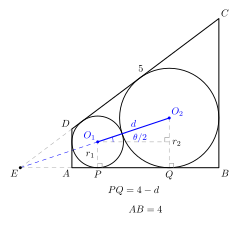
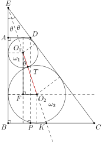

# 2026 AMC 12A Problem 24

## Problem 24
Trapezoid $ABCD$ has $AB = 4$, $CD = 5$, and $\angle DAB = \angle ABC = 90^\circ$. Circles $\omega_1$ and $\omega_2$ lie inside the trapezoid as follows: $\omega_1$ is tangent to $\overline{AB}$, $\overline{AD}$, and $\overline{DC}$; $\omega_2$ is tangent to $\overline{AB}$, $\overline{BC}$, and $\overline{DC}$; and $\omega_1$ and $\omega_2$ are externally tangent to each other. The distance between the centers of $\omega_1$ and $\omega_2$ is $m - n\sqrt{p}$, where $m$, $n$, and $p$ are positive integers such that $p$ is not divisible by the square of any prime. What is $m + n + p$?

$\textbf{(A)}\quad 30 \qquad\qquad \textbf{(B)}\quad 47 \qquad\qquad \textbf{(C)}\quad 53 \qquad\qquad \textbf{(D)}\quad 62 \qquad\qquad \textbf{(E)}\quad 74$

## Diagram

~ Aeioujyot

## Solution 1
Let the circles have centers $O_1,O_2$ and radii $r_1,r_2$. We write $d=O_1O_2$. Since the circles are externally tangent,

$$
d=r_1+r_2.
$$

Let $P,Q$ be the feet of the perpendiculars from $O_1,O_2$ to $AB$. Tangency to $AD$ and $BC$ gives $AP=r_1$ and $QB=r_2$. Thus

$$
PQ=AB-AP-QB=4-r_1-r_2=4-d.
$$

Extend $AB$ and $CD$ to meet at $E$, and let $\theta=\angle DEB$. Each center is equally distant from the lines $AB$ and $CD$, so both centers lie on the same angle bisector. Therefore, $O_1O_2$ makes an angle of $\frac{\theta}{2}$ with $AB$.

Since $AD$ and $BC$ are perpendicular to $AB$, the projection of $CD$ onto $AB$ has length $4$. Hence

$$
\cos\theta=\frac{4}{5},
\qquad
\cos\frac{\theta}{2}
=\sqrt{\frac{1+\frac45}{2}}
=\frac3{\sqrt{10}}.
$$

Projecting $O_1O_2$ onto $AB$ gives

$$
4-d=PQ=d\cos\frac{\theta}{2}
=\frac{3d}{\sqrt{10}}.
$$

Solving,

$$
d=\frac{4\sqrt{10}}{\sqrt{10}+3}
=40-12\sqrt{10}.
$$

Thus $m+n+p=40+12+10=\boxed{62}$, we choose $\boxed{\textbf{(D)}}$.

~SZ624

## Solution 2 (Constructions)
### Diagram

### Solution
Let $r_1$ and $r_2$ be the radii of $\omega_1$ and $\omega_2$, with centers $O_1$ and $O_2$. Extend $BA$ and $CD$ to meet at $E$. Since both circles are tangent to $EB$ and $EC$, both centers lie on the angle bisector of $\angle BEC$. Let this bisector meet $BC$ at $K$, and let $\angle BEK = \angle KEC = \theta$.

Now, drop the perpendicular from $O_1$ to $BC$, and draw the line through $O_2$ parallel to $BC$. Let these lines meet at $F$. Since the circles are externally tangent at $T$, and both are tangent to $AB$,

$$
O_1O_2 = r_1 + r_2, \qquad O_2F = r_2 - r_1, \qquad O_1F = 4 - r_1 - r_2.
$$

Let $P$ be the projection of $D$ onto $BC$. Then $DP = AB = 4$ and $DC = 5$, so $\triangle DPC$ is a $3$-$4$-$5$ triangle with $PC = 3$. Since $DP \parallel EB$, we have $\triangle EBC \sim \triangle DPC$, so $EB : BC : EC = 4 : 3 : 5$.

By the Angle Bisector Theorem on $\triangle EBC$,

$$
\frac{BK}{KC} = \frac{EB}{EC} = \frac{4}{5}, \quad\text{so}\quad BK = \frac{4}{9}BC.
$$

Then $\frac{BK}{EB} = \frac{4}{9}\cdot\frac{3}{4} = \frac{1}{3}$, so $\triangle EBK$ is a $1 : 3 : \sqrt{10}$ right triangle with $BK : EB : EK = 1 : 3 : \sqrt{10}$.

Since $O_1F \parallel EB$, we have $\angle FO_1O_2 = \angle BEK = \theta$, so $\triangle O_1FO_2 \sim \triangle EBK$. Therefore

$$
O_2F : O_1F : O_1O_2 = 1 : 3 : \sqrt{10}.
$$

Let $d = r_1 + r_2$. Using $O_1F : O_1O_2 = 3 : \sqrt{10}$,

$$
\frac{4 - d}{d} = \frac{3}{\sqrt{10}} \implies 4\sqrt{10} = d\left(\sqrt{10} + 3\right) \implies d = \frac{4\sqrt{10}}{\sqrt{10} + 3}.
$$

Rationalizing the denominator,

$$
d = 4\sqrt{10}\left(\sqrt{10} - 3\right) = 40 - 12\sqrt{10}.
$$

Thus $O_1O_2 = 40 - 12\sqrt{10}$, so $m + n + p = 40 + 12 + 10 = \boxed{\textbf{(D)}~62}$.

~ Aeioujyot

### Remark
This was one of the coolest geo problems I've seen on the AMCs in a good while. The solution above was my solution during the actual test. Eww coordinates :D

~I agree, this felt more like an AIME geo.

## Solution 3
Let $A=(0,0)$, $B=(4,0)$, $D=(0,h)$, and $C=(4,h+3)$.

Since $AB=4$ and $CD=5$, the Pythagorean theorem gives the vertical difference between $C$ and $D$ as $3$.

The equation of line $DC$ is

$$
3x-4y+4h=0.
$$

Let the radii of $\omega_1$ and $\omega_2$ be $r_1$ and $r_2$, respectively.

Since $\omega_1$ is tangent to both $AB$ and $AD$, its center is $(r_1,r_1)$.

Since $\omega_2$ is tangent to both $AB$ and $BC$, its center is $(4-r_2,r_2)$.

Using the distance formula for a point and a line, the tangency of $\omega_1$ to $DC$ gives

$$
\frac{3r_1-4r_1+4h}{5}=r_1.
$$

Simplifying,

$$
4h-r_1=5r_1
$$

$$
r_1=\frac{2h}{3}.
$$

Similarly, the tangency of $\omega_2$ to $DC$ gives

$$
\frac{3(4-r_2)-4r_2+4h}{5}=r_2.
$$

Simplifying,

$$
12+4h=12r_2
$$

$$
r_2=1+\frac{h}{3}.
$$

Since the circles are tangent to each other, the distance between their centers equals the sum of their radii. Thus,

$$
(4-r_1-r_2)^2+(r_2-r_1)^2 =(r_1+r_2)^2.
$$

Expanding and simplifying,

$$
(r_2-r_1)^2=8(r_1+r_2)-16.
$$

Substituting our expressions for the radii,

$$
\left(1-\frac{h}{3}\right)^2 =8(h+1)-16.
$$

Multiplying by $9$ and simplifying,

$$
h^2-78h+81=0.
$$

Using the quadratic formula,

$$
h=\frac{78\pm\sqrt{78^2-4(81)}}{2}
$$

$$
h=39\pm12\sqrt{10}.
$$

Since the circles must fit inside the trapezoid, we take the smaller root:

$$
h=39-12\sqrt{10}.
$$

Finally, the distance between the centers is

$$
r_1+r_2=1+h.
$$

Therefore,

$$
d=40-12\sqrt{10}.
$$

Hence, $m=40$, $n=12$, and $p=10$, so

$$
m+n+p=40+12+10=\boxed{62}.
$$

The answer is $\boxed{\text{(D) }62}$.
$\sim$Cyrus825
