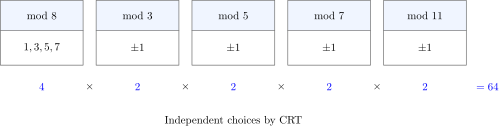

# 2026 AMC 12A Problem 25

## Problem
Let $m$ be a positive integer such that there are at least $50$ positive integers $x$ less than $m$ for which $x^2-1$ is a multiple of $m$. What is the sum of the digits of the least possible value of $m$?

$\mathbf{(A)} 12\qquad\mathbf{(B)} 15\qquad\mathbf{(C)} 16\qquad\mathbf{(D)} 18\qquad\mathbf{(E)} 22$

## Solution 1
Let $p^k$ be the largest power of a prime $p$ that divides $x^2-1$. We focus on the exponent of each prime involved. First, if $p\ge 3$, then we have

$$
x^2\equiv 1\pmod{p^k}\implies (x+1)(x-1)\equiv 0\pmod{p^k}
$$

But $x+1$ and $x-1$ cannot both be divisible by $p$ since then $x+1\equiv x-1\equiv 0\pmod{p}\implies 2\equiv 0\pmod{p}$, which is false. Therefore, all powers of $p$ must be “stored” in either $x+1$ or $x-1$, hence $x\equiv \pm 1\pmod{p^k}$. As a result, each odd prime power contributes a multiplication of $2$, or a doubling, to the total number of solutions by the Chinese Remainder Theorem.

For $p=2$, we may use the above argument, except that both $x+1$ and $x-1$ may be divisible by $2$, but only one may be divisible by $4$. Therefore, one of $x+1$ and $x-1$ is even, and the other is divisible by $2^{k-1}$. This implies that $x\equiv \pm 1\pmod{2^{k-1}}$, so at most $4$ solutions exist to $x^2\equiv 1\pmod{2^k}$. We perform casework on the precise value of $k$.

When $k=0$, there are no solutions created (clear). When $k=1$, then there is exactly one solution contribution, so the number of solutions does not increase. When $k=2$, then $x\equiv \pm 1\pmod{2}$, hence $x\equiv 1,3\pmod{4}$, resulting in a doubling of the number of solutions. Finally, when $k\ge 3$, then $x\equiv 1,2^{k-1}-1,2^{k-1}+1,2^k-1\pmod{2^k}$, resulting in a quadrupling of the number of solutions.

From our analysis above, we see that $m$ being divisible by two copies of the same odd prime does not increase the number of solutions, hence $m$ should be squarefree with respect to odd primes. We also know that we should have $k\le 3$ for $p=2$, otherwise we are wasting powers of $2$; we also do not have $k=1$ since $k=0$ is better. Finally, we perform casework on the value of $k$ for $p=2$ (also known as $\nu_2$):
- When $k=0$, the minimum is $3\cdot 5\cdot 7\cdot 11\cdot 13\cdot 17$, which produces $2^6=64$ solutions.
- When $k=2$, the minimum is $2^2\cdot 3\cdot 5\cdot 7\cdot 11\cdot 13$, which produces $2^6=64$ solutions.
- When $k=3$, the minimum is $2^3\cdot 3\cdot 5\cdot 7\cdot 11$, which produces $4\cdot 2^4=64$ solutions.

By direct comparison, we see that $k=3$ produces the smallest $m$. Evaluating directly yields $9240$. The sum of the digits is $15$, or $\boxed{\textbf{(B)}}$.

~ [eevee9406](https://artofproblemsolving.com/wiki/index.php/User:Eevee9406)

## Solution 2
We want the least $m$ such that at least 50 integers $x$, with $1\le x<m$, satisfy

$$
x^2\equiv 1\pmod m.
$$

Notice that $x^2-1=(x-1)(x+1)$. Since $x-1$ and $x+1$ differ by $2$, they cannot both be divisible by an odd prime.

Thus, for every odd prime power dividing $m$, there are exactly $2$ possible residues: $x\equiv 1$ or $-1$.

Let us now consider the powers of $2$. Looking at modulo $8$, we see that all four odd residues $1,3,5,7$ satisfy $x^2\equiv 1\pmod 8$.

For higher powers $2^a$, notice that exactly one of $x-1$ and $x+1$ is divisible by $4$, while the other has exactly one factor of $2$. Thus, if $2^a\mid(x-1)(x+1)$, we must have

$$
x\equiv\pm1\pmod{2^{a-1}}.
$$

Each residue gives at most two possibilities modulo $2^a$, so there can never be more than $4$ solutions. 

By the Chinese Remainder Theorem, if $m$ is divisible by $8$ and has $k$ distinct odd prime factors, then there are $4\cdot 2^k$ solutions modulo $m$. Indeed, for all $a \geq 3$, the four residues $1, -1, 1+2^{a-1}, -1+2^{a-1}$ all satisfy the congruence modulo $2^a$.

We need at least 50 solutions, so we want

$$
4\cdot 2^k\ge 50.
$$

The smallest possible $k$ is $4$, giving $64$ solutions.

To minimize $m$, we choose the four smallest odd primes, $3,5,7,11$, along with $8$. Thus,

$$
m=8\cdot3\cdot5\cdot7\cdot11=9240.
$$

The sum of the digits of $9240$ is $\boxed{15}.$

~lprado

## Solution 3
First, we try

$$
m_0=8\cdot3\cdot5\cdot7\cdot11=9240.
$$

Modulo $8$, all four odd residues work; modulo each odd prime, the two residues $\pm1$ work. The Chinese Remainder Theorem gives $4\cdot2^4=64$ solutions, so the least possible $m$ satisfies $m\le9240$.

To prove minimality, note that $\gcd(x-1,x+1)\mid2$. Thus each odd prime power $p^e$ allows exactly two roots, $x\equiv\pm1\pmod{p^e}$. A power $2^a$ allows at most four: for $a\ge3$, one of $x-1,x+1$ has exactly one factor of $2$, forcing

$$
x\equiv\pm1\pmod{2^{a-1}}.
$$

For $a\le2$, there are at most two roots.

Let $k$ be the number of distinct odd prime factors of $m$. If $k\le3$, there are at most $4\cdot2^3=32$ solutions. If $k\ge5$, then

$$
m\ge3\cdot5\cdot7\cdot11\cdot13=15015>9240,
$$

also impossible. Hence $k=4$.

Since $2\cdot2^4=32<50$, the power of $2$ must contribute more than two roots, requiring $8\mid m$. Therefore

$$
m\ge8\cdot3\cdot5\cdot7\cdot11=9240.
$$

Equality is attainable by our construction, so the answer is

$$
9+2+4+0=\boxed{\text{(B)}\ 15}.
$$

~SZ624
